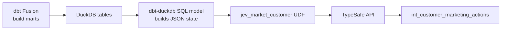

# Calling Typed AI from SQL: Jev, dbt, and DuckDB

*A small experiment on Jaffle Shop — integration pattern, not a benchmark.*

---

Most teams run LLM workflows in notebooks or microservices. Analysts still live in SQL. This post shows one way to close that gap: register a Python UDF in **dbt-duckdb**, call **Jev** (TypeSafe System One) from a SQL model, and materialize typed marketing fields like any other mart.

**What this is:** a reproducible wiring demo on ~100 customers.
**What it is not:** proof that the model is “right,” or that per-row inference scales in production.

---

## The shape



Two dbt environments on purpose:

1. **dbt Fusion** — everyday Jaffle Shop builds (`make build-dbt-v2`).
2. **dbt-duckdb** — loads a plugin that registers `jev_market_customer(state_json)` on the DuckDB connection (`make build-jev-udf`).

Fusion’s DuckDB adapter cannot register Python UDFs today. A sidecar env is the pragmatic trade-off.

---

## Register the UDF

`profiles-jev/profiles.yml` points at a small plugin:

```yaml
module_paths: ["{{ env_var('PWD') }}/src"]
plugins:
  - module: jaffle_shop_core_v2.jev_plugin
```

The plugin creates a DuckDB function that wraps TypeSafe’s SDK:

```python
def register_jev_market_customer(conn, client):
    def jev_market_customer(state_json: str) -> str:
        return market_customer_json(state_json, client)

    conn.create_function("jev_market_customer", jev_market_customer, side_effects=True)
```

`side_effects=True` matters: each row hits the network.

---

## Call it from SQL

The model `int_customer_marketing_actions` (disabled by default) samples the top 20 customers by order count, builds a JSON blob of profile + recent orders, and calls the UDF once per row:

```sql
select
    customer_id,
    jev_market_customer(customer_state) as marketing_json
from customer_state
```

Structured answers are parsed into columns: `next_best_offer`, promo propensity (NOUL), and `campaign_priority` (score).

Example output (top 5 by priority):

| customer_id (truncated) | next_best_offer | conf | priority |
| ------------------------- | ----------------- | ------ | ---------- |
| 3483e39a… | loyalty_reward | 0.93 | 1.70 |
| 5fccc95a… | loyalty_reward | 0.93 | 1.67 |
| 2609004e… | loyalty_reward | 0.91 | 1.67 |
| 9ff834d1… | loyalty_reward | 0.91 | 1.67 |
| d31efffd… | loyalty_reward | 0.89 | 1.66 |

On this tiny slice, Jev mostly agreed these heavy buyers deserve a loyalty touch. That’s anecdotal — the point is the **table is queryable and testable** (`accepted_values`, `not_null`, etc.).

---

## One row in, one row out

**Input** (trimmed; no `customer_name` in state):

```json
{
  "profile": {
    "customer_id": "3483e39a-…",
    "count_lifetime_orders": 231,
    "customer_type": "returning",
    "lifetime_spend": 1396.02
  },
  "recent_orders": [
    {
      "ordered_at": "2025-08-31T00:00:00",
      "items": [{"product_name": "tangaroo", "product_type": "beverage"}]
    },
    {
      "ordered_at": "2025-08-30T00:00:00",
      "items": [{"product_name": "tangaroo", "product_type": "beverage"}]
    }
  ]
}
```

**Output:**

```json
{
  "next_best_offer": "loyalty_reward",
  "next_best_offer_confidence": 0.91,
  "likely_to_redeem_promo": 0.71,
  "campaign_priority": 1.64,
  "campaign_priority_confidence": 0.47
}
```

Three question types in one call: **choice**, **NOUL**, **score** — no string parsing in downstream SQL.

---

## Latency (N = 20)

Measured with `make experiment-jev-article` after the mart build. Sequential calls, `threads: 1`.

| Metric | ms |
| -------- | ----- |
| Total | 3,176 |
| Cold start (row 1) | 308 |
| Warm mean (rows 2–20) | 151 |
| p50 | 152 |
| p95 | 213 |

Roughly **~150ms per warm call** — dominated by the TypeSafe round trip, not DuckDB. Twenty rows took about three seconds. That’s fine for a demo; it is not a production batch design.

---

## Try it

```bash
# .env with JEV_API_KEY or TYPESAFE_API_KEY
make build-dbt-v2
make build-jev-udf
make experiment-jev-article   # optional: latency + JSON artifacts
```

The harness writes `article/artifacts/jev_responses.jsonl` and `jev_latency_summary.json`, and loads `raw.jev_benchmark_runs` for SQL analysis.

---

## Honest limits

- **Small data** — top 20 of ~100 customers; scores are illustrations.
- **Two dbt installs** — Fusion for marts, dbt-duckdb for UDFs.
- **One API call per row** — use batching or pre-compute outside SQL for real scale.
- **Duplicate work** — `build-jev-udf` and `experiment-jev-article` both call the API unless you instrument the UDF path directly.

---

## Takeaway

The interesting part isn’t whether `loyalty_reward` is the right offer for customer `3483e39a…`. It’s that **typed AI output can live in the warehouse layer**: versioned in git, tested in dbt, joined like any mart — once you accept a Python UDF sidecar and keep inference off the critical path of every ad-hoc query.

Code and repro steps live in the [jaffle-shop-meets-dbt-v2](https://github.com/yu-iskw/jaffle-shop-meets-dbt-v2) repo (Jev marketing section in the README).
